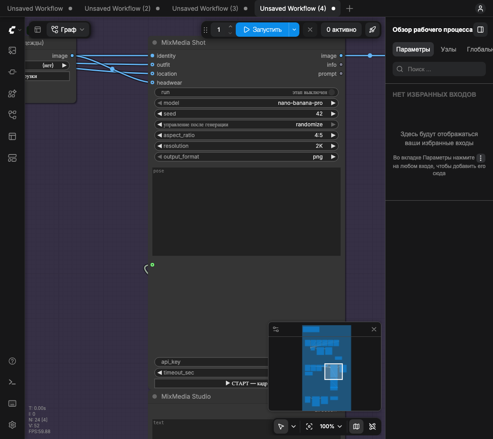

# ComfyUI + MixMedia — фотостудия на нодах

Полная инструкция: что стоит, как запускать, как снимать фотосессию, сколько это стоит,
что делать, когда что-то упало, и как это всё чинить/обновлять.

Коротко: ComfyUI 0.43.0 в своём приложении на macOS, рядом — пакет нод для API MixMedia
(Nano Banana Pro и соседние модели). Один воркфлоу-файл, три независимых этапа: лист персонажа →
кадр → докрутка камеры. Промпт не пишется руками и не пишется одной простынёй: он собирается из
того, что подключено к нодам и что выставлено в Studio.



---

## 1. Что это умеет

| Этап | Что делает | Выход |
|---|---|---|
| 1. Персонаж | 2–6 фото лица → один лист 2×2: фронт, три четверти, профиль, в полный рост | `character_ref_*.png` |
| 2. Кадр | персонаж + одежда + локация + головной убор + поза текстом + Studio → фотография | `shot_*.png` |
| 3. Докрутка | готовый кадр → тот же кадр с другой камерой (поворот, зум, высота, объектив) | `retake_*.png` |

Почему этапы раздельные: лист персонажа платный и его хватает надолго; кадров нужно много;
докрутка — это отдельная генерация на каждый шаг. Если сцепить всё в одну цепочку, каждый кадр
тянул бы за собой пересборку персонажа, то есть деньги в пустоту.

Ноды пакета:

| Нода | Роль |
|---|---|
| **MixMedia Character** | лист персонажа из фото лица (этап 1) |
| **MixMedia Shot** | кадр: нумерует подключённые референсы, добавляет позу и выход Studio (этап 2) |
| **MixMedia Studio** | камера, свет, объектив, фон, объекты, бриф → текстовый блок для Shot |
| **MixMedia Direction** | бриф текстом + две ручки силы контекста и деталей → в `Studio.direction` |
| **MixMedia Retake** | докрутка камеры готового кадра (этап 3) |
| **MixMedia Ref (пусто = нет)** | референс из `input` или «(нет)»: пустой вход не ломает запуск |
| **MixMedia Image** | обычная генерация/редактирование по промпту и любым референсам |
| **MixMedia Balance** | показать баланс, не тратя денег |

---

## 2. Файлы и раскладка

| Что | Путь |
|---|---|
| ComfyUI 0.43.0 | `comfyui/` |
| Ноды MixMedia | `comfyui/custom_nodes/comfyui-mixmedia/` (Python + расширение UI в `web/js/`) |
| API-ключ | `.mixmedia_key` (права 600), в установленном приложении — `~/.mixmedia_key` |
| Воркфлоу «фотостудия» | `photostudio_mixmedia.json` (копия — `comfyui/user/default/workflows/`) |
| Референсы | `comfyui/input/` |
| Результаты | `comfyui/output/` |
| Промпты всех генераций | `comfyui/output/_prompts/<дата-время>.txt` |
| Генератор воркфлоу | `tools/make_mixmedia_workflows.py` |
| Окно приложения | `desktop/ComfyUIApp.m` (основное), `desktop/mixmedia_window.py` (запасное) |
| Сборка приложения и DMG | `tools/make_installer.sh` → `dist/ComfyUI Mix Media.dmg` |
| Установленное приложение | `/Applications/ComfyUI Mix Media.app` (внутри — вся сборка) |
| Лог сервера | `~/Library/Logs/ComfyUI Mix Media.log` |
| launchd-задача сервера | `~/Library/LaunchAgents/local.mixmedia.comfyui.plist` |

Воркфлоу продублирован в `comfyui/user/default/workflows/` — открывается из сайдбара ComfyUI
(«Рабочие процессы»).

---

## 3. Запуск

### Приложение (обычный способ)

`ComfyUI Mix Media Installer.dmg` → дважды кликнуть → перетащить **ComfyUI Mix Media** в `Applications`.
Дальше — из Launchpad/Applications, как обычное приложение.

Открывается **своё окно** (objc-бинарник `ComfyUIApp`, внутри WKWebView): ни вкладок, ни адресной
строки, ни меню Chrome. Меню: **Правка** (⌘C/⌘V/⌘Z работают), **Вид** (⌘R обновить, ⌘+ / ⌘− масштаб,
⌘0 обычный), **Окно**. Размер и положение окна запоминаются. Внешние ссылки открываются в браузере.

Что происходит при запуске:

1. лаунчер проверяет, поднят ли сервер на `127.0.0.1:8188`;
2. если нет — пишет launchd-задачу `local.mixmedia.comfyui` и стартует её;
3. ждёт ответа сервера (до 90 с), показывает страницу «поднимаю сервер…»;
4. открывает окно с UI.

Сервер живёт **отдельно** от окна: закрыл окно — сервер работает, идущая генерация не рвётся.
Остановить: `launchctl bootout gui/$(id -u)/local.mixmedia.comfyui`.

### Из папки проекта (для разработки)

```bash
cd /Users/smutmuv/Downloads/3
.venv/bin/python comfyui/main.py --listen 127.0.0.1 --port 8188 --auto-launch
```

Или `start_comfyui.command` в проекте.

### Перезапуск сервера

Перед рестартом **проверь очередь**: `curl -s http://127.0.0.1:8188/queue`. Рестарт убивает
выполняющийся промпт, а задача в MixMedia уже оплачена — деньги в пустоту.

```bash
curl -s http://127.0.0.1:8188/queue                      # должно быть пусто
launchctl kickstart -k gui/$(id -u)/local.mixmedia.comfyui
```

После правки `nodes.py` перезапуск обязателен; после правки `web/js/*.js` — достаточно ⌘R (и
⌘⇧R, если браузер закешировал).

---

## 4. Ключ, баланс и три привычки

* Ключ лежит в `.mixmedia_key` (в установленном приложении — `~/.mixmedia_key`), нода читает его сама.
  **Поле `api_key` в ноде оставляй пустым**: если вписать ключ туда, он попадёт в JSON воркфлоу
  и уедет вместе с файлом.
* Баланс печатается в лог после каждой генерации: `cost=$0.05 balance=$10.62`.
  Пополнение: https://mixmedia.tech/cabinet/billing
* **Не жми Cancel во время генерации.** Задача на стороне MixMedia уже создана и оплачена;
  отмена в ComfyUI выбрасывает результат, деньги не возвращаются. Pro в 2K идёт 40–90 с,
  4K — до ~5 минут; прогресс-бар в ноде показывает, что работа идёт.
* Выключенный этап (`run` = «этап выключен») не тратит денег и не даёт красных ошибок: в логе
  просто строка «MixMedia … выключен».

---

## 5. Один файл, три этапа

`photostudio_mixmedia.json` — один холст, три группы, **между собой не связанные**:

| Этап | Входы | Выход (SaveImage) |
|---|---|---|
| 1. Персонаж | 6 × `LoadImage` (лицо) → `Batch Images` | `character_ref` |
| 2. Кадр | персонаж, одежда, локация, убор, поза, Studio | `shot` |
| 3. Докрутка | готовый кадр | `retake` |

### Кнопка «▶ СТАРТ»

Внизу каждой ноды-этапа есть кнопка **«▶ СТАРТ — лист персонажа / кадр / докрутка»**.
Один клик: включает этот этап, выключает два других, сразу ставит очередь. Сверху справа
появляется подсказка, что включено, а что погашено. Вручную ничего щёлкать не нужно.

Если кнопки не видно — ⌘⇧R (её рисует расширение ноды `web/js/mixmedia_stages.js`), и открой
воркфлоу заново.

### Тумблер `run` (ручной способ)

В той же ноде первым виджетом идёт `run`: «ЭТАП ВКЛЮЧЁН / этап выключен». Это то же самое,
что делает кнопка СТАРТ, только руками.

Выключенный этап возвращает блокер без текста: `SaveImage` его молча пропускает — ни запроса,
ни денег, ни красного Error Report. Если нажать обычный Run с выключенным этапом, очередь
отработает за 0.05 с и ничего не сохранит: это не сбой, а выключенный тумблер.

Мьютить (`Ctrl+M`) выходные ноды **не нужно** — они всегда активны и всегда на месте.
Раньше так делали, и ComfyUI ругался «нет выходных узлов».

---

## 6. Этап 1 — лист персонажа

Смысл: один раз собрать человека со всех ракурсов **в одной картинке** и дальше кидать только её.

1. Жми **СТАРТ** на этапе 1 (он включён по умолчанию).
2. В группе 6 нод `LoadImage`, подключённых к `Batch Images` → `identity`. Выбери свои фото:
   фронт, три четверти, профиль, ещё несколько. Лишние ноды просто удали (`Delete`) — входы
   останутся пустыми, это норм.
3. `look` — словами: `short textured hair, light stubble`.
4. Run/СТАРТ. Получится лист 2×2, 4096×4096, **$0.065**.
5. Сходство слабое — меняй исходники и перегенерируй лист, пока не станет похоже. Дальше все
   кадры наследуют именно его.

Хорошие исходники: дневной рассеянный свет, лицо открыто, нейтральное выражение, резкий кадр,
без фильтров. Плохие: селфи в тёмной ванной, вспышка в упор, очки, волосы на глазах, ракурс снизу.

Лист сохраняется в `comfyui/output/character_ref_*.png`. Чтобы выбрать его в этапе 2, скопируй
файл в `comfyui/input/` (или перетащи прямо в окно ComfyUI — он появится в списке `LoadImage`).

---

## 7. Этап 2 — кадр

```
LoadImage «Персонаж»  ─┐
LoadImage «Одежда»    ─┤
LoadImage «Локация»   ─┼─→ MixMedia Shot ─→ SaveImage
MixMedia Ref «Убор»   ─┘        ↑
                        MixMedia Studio ─┘
```

Что кидать:

* **Персонаж** — один файл: лист из §6. Можно и батч из 2–3 фото лица, но тогда лист не нужен.
* **Одежда** — 1–4 фото вещей. Лучше на человеке или манекене; flat-lay тоже работает, но посадку
  модель придумает сама.
* **Локация** — картинка места (интерьер, улица, студия). Свет берётся оттуда.
* **Поза** — текстом в поле `pose` на самом `MixMedia Shot`: `сидит на подоконнике, колени к груди`,
  `стоит спиной, смотрит через плечо`. Пусто → поза вообще не упоминается.
* **Головной убор** — нода `MixMedia Ref`. `(нет)` → берётся с фото одежды (в промпте появляется
  «одеть ровно эти вещи, включая головной убор, если он есть на фото»). Выбрал файл — появляется
  своя строка `image N: the headwear — ...`.

Почему для убора отдельная нода, а не `LoadImage`: обычный `LoadImage` нельзя оставить пустым —
он падает на исполнении и валит всю очередь («Invalid image file»), даже если вход необязательный.
`MixMedia Ref` в состоянии `(нет)` отдаёт пустой батч, и референс не уходит в API.

`MixMedia Shot` своего промпта не имеет: она только описывает, какой референс за что отвечает.
Всё остальное — то, что накручено в **MixMedia Studio** (и/или в `MixMedia Direction`).

### Ручки Studio

| Ручка | Значения |
|---|---|
| `text` | свободный бриф словами |
| `framing` | auto, wide, full body, three-quarter, waist, bust, close-up, detail |
| `angle` | auto, front, three-quarter left/right, profile left/right, from behind, from above |
| `camera_height` | auto, floor level, eye level, above the head |
| `lens` | auto, 16 / 24 / 35 / 50 / 85 / 135 / 200 мм, 100 мм макро |
| `light_setup` | auto, софтбокс 45°, два софтбокса, жёсткий свет справа, окно, ринг, контровой, золотой час, пасмурно, бьюти-диш |
| `light_temp` | auto, 3200K (тепло), 5600K (нейтрально), 7500K (холод) |
| `light_contrast` | auto, soft, medium, hard |
| `backdrop` | auto, серый/белый цилорама, чёрный, бумага, без фона (взять локацию) |
| `props` | что добавить в кадр: стул, цветы, дым, машина |
| `avoid` | чего в кадре быть не должно |

Всё в `auto` — значит «не упоминать, пусть решают референсы». Ручки в `auto` в промпт не попадают.

### Direction (необязательно)

Стоит перед Studio: текст + две ручки; его выход идёт в `Studio.direction` и дописывается
последним блоком.

| Ручка | 0 | 0.5 | 1 |
|---|---|---|---|
| `context_strength` | сцену задают референсы локации и позы, бриф только про настроение | баланс | сцену задаёт бриф |
| `detail_strength` | детали берутся с референсов, ничего не выдумывать | среднее | всё из брифа рисуется буквально: ткань, швы, фурнитура, принты, макияж |

### Что реально уходит в API

Нода нумерует подключённые картинки и пишет только это:

```
Compose one new photo from these references:
image 1: the person — exact face, hair, body proportions
image 2: the clothes — dress the person in exactly these pieces
image 3: the place — put the person inside this exact space and light

POSE — сидит на подоконнике, колени к груди                     ← из поля pose на Shot

CAMERA — full-body framing, head to toe, camera straight in front of the model, lens at eye level, 85mm lens.
LIGHT — softbox at 45 degrees from camera left, neutral 5600K, soft.
SET — backdrop: grey cyclorama; add to the frame: a wooden stool.
BRIEF — clean studio test, calm expression, sharp eyes
```

Готовый текст пишется в лог и в `comfyui/output/_prompts/<дата>.txt`; выход `prompt` у ноды можно
подключить к `PreviewAny`, если хочется смотреть в UI. Хочешь поправить формулировку — правь её
в Studio, а не в коде.

Лимит референсов у Pro — 8 на запрос; лишние фото личности отрезаются автоматически с
предупреждением в логе (порядок среза: головной убор, локация, одежда, потом лишние фото лица).

---

## 8. Этап 3 — докрутить камеру

```
LoadImage «кадр» ─→ MixMedia Retake ─→ SaveImage
```

Кадр из §7 кидаешь в `LoadImage`, крутишь:

| Ручка | Что делает |
|---|---|
| `turn` | поворот камеры вокруг модели: **+ влево, − вправо**, ±90° шагом 5 |
| `zoom` | **+ ближе, − дальше**, ±50% |
| `camera_height` | **+ поднять камеру, − опустить**, ±30° |
| `lens` | сменить объектив на том же кадре |
| `text` | любая правка: свет, выражение, детали |

Промпт: «то же фото, тот же человек, та же одежда и свет — меняем только камеру». Референс — сам
кадр, поэтому личность и одежда не плывут.

Каждый Retake — новая генерация и новые деньги ($0.05 в 2K). Докручивай по одному шагу: сначала
поворот, потом зум, а не всё сразу.

---

## 9. Модели, разрешения, цены

| Модель | Разрешения | Референсы | 1K | 2K | 4K |
|---|---|---|---|---|---|
| `nano-banana-pro` | 1K, 2K, 4K | 8 | $0.05 | $0.05 | $0.065 |
| `nano-banana-2` | 0.5K, 1K, 2K, 4K | 10 | $0.025 | $0.035 | $0.04 |
| `nano-banana` | 1K, 2K | 10 | $0.03 | $0.03 | — |
| `gpt-image-2.5` | 1K, 2K, 4K | 16 | $0.04 | $0.04 | $0.06 |
| `seedream-pro` / `flash` | 1K, 1.5K, 2K | 10 | $0.05 / $0.025 | $0.095 / $0.025 | — |
| `flux-dev` | — | 0 | $0.033 | — | — |

Если разрешение или пропорции модель не поддерживает, нода подставляет ближайшее допустимое и
пишет предупреждение в лог, а не падает.

---

## 10. Если что-то не так

| Симптом | Что делать |
|---|---|
| Красный Error Report «ExecutionBlocked» | так было раньше с выключенным этапом. Сейчас не появляется; если увидел — обнови приложение |
| `MixMedia 402` | пополни баланс (Pro доступен после первого пополнения) |
| `MixMedia 401` | ключ в `.mixmedia_key` неверный или отключён |
| `MixMedia 400` | параметр не поддержан моделью; нода подставляет допустимый сама |
| `nothing to send` | не подключён ни один референс и Studio пустая — добавь картинку или бриф |
| `Invalid image file` | в `LoadImage` выбран файл, которого нет в `input` (или ничего не выбрано). Для необязательных референсов есть `MixMedia Ref` с `(нет)` |
| Долго «висит» | норма: 40–90 с, 4K до ~5 минут; смотри прогресс-бар, не жми Cancel |
| `RemoteDisconnected` / обрыв сети | нода сама повторяет запросы (6 попыток, опрос — до конца `timeout_sec`). Если всё-таки упало — см. §11, задача уже оплачена |
| `timeout_sec` вышел | 4K иногда считается ~5 минут; по умолчанию 900 с, можно поднять до 1800 |
| Нода пропала после обновления | перезапусти сервер, проверь лог на `comfyui-mixmedia` |
| Кнопки СТАРТ нет | ⌘⇧R и открой воркфлоу заново; расширение лежит в `custom_nodes/comfyui-mixmedia/web/js/` |
| Лицо не похоже | больше и лучше фото в `identity`, сначала собери нормальный лист персонажа |
| Кадр «не тот» | посмотри промпт в `output/_prompts`: чего в нём не хватает — то и не задано |
| Одежда «не та» | дай фото вещи на человеке + `props`/`text`: посадка, ткань, как сидит |

---

## 11. Если задача упала после оплаты

Бывает: сеть оборвалась, ноут уснул, `timeout_sec` кончился — а задача уже создана и оплачена.
Картинка живёт на сервере MixMedia **24 часа**, её можно забрать руками:

```bash
python tools/fetch_task.py task_nano-banana-pro_17934676749245876e3
# или с указанием папки:
python tools/fetch_task.py <taskId> --out ~/Downloads
```

`taskId` есть в логе (`task task_...: nano-banana-pro, 4K, refs=4`) и в тексте ошибки.
Скрипт сам опрашивает статус, скачивает `resultUrls` в `output/` (или `./recovered`) и пишет цену.

Так однажды и спасли лист персонажа за $0.065: генерация прошла, а опрос статуса упал на
`RemoteDisconnected`.

---

## 12. Правки и разработка

Промпт — это чистый шаблон, LLM не участвует:

* `shot_prompt()` — нумерация референсов + блок `POSE` + выходы Studio/Direction;
* `studio_prompt()` — блоки CAMERA / LIGHT / SET / BRIEF только из ручек, отличных от `auto`;
* `retake_prompt()` — «то же фото, меняем только камеру» + дельты.

Списки значений ручек и тексты блоков — в `nodes.py` (`FRAMINGS`, `ANGLES`, `LENSES`,
`LIGHT_SETUPS`, `studio_prompt`, `retake_prompt`). Раскладка воркфлоу — в
`tools/make_mixmedia_workflows.py`:

```bash
.venv/bin/python tools/make_mixmedia_workflows.py
cp photostudio_mixmedia.json comfyui/user/default/workflows/
```

Проверки (все бесплатные):

```bash
.venv/bin/python tools/test_prompts.py                        # промпты и execute() с моком API
python3 tools/validate_workflow.py photostudio_mixmedia.json  # сверка типов/виджетов с /object_info
node tools/e2e/check-workflows.js photostudio_mixmedia.json   # загрузка в реальном фронтенде
node tools/e2e/check-link.js photostudio_mixmedia.json        # линки и значения виджетов
node tools/e2e/check-run.js photostudio_mixmedia.json         # какие этапы уйдут в очередь
node tools/e2e/check-start-button.js photostudio_mixmedia.json # клик по СТАРТ: ровно один этап
node tools/e2e/dump-api.js photostudio_mixmedia.json > /tmp/p.json && \
  .venv/bin/python tools/validate_api.py /tmp/p.json          # оффлайн-валидация промпта, без денег
```

Перезапуск сервера после правки `nodes.py` обязателен, очередь перед этим должна быть пуста.

### Пересборка приложения и установщика

```bash
./tools/make_installer.sh           # полная сборка payload + окно + DMG (~8 минут)
./tools/make_installer.sh --reuse   # только окно/лаунчер/иконка/DMG, payload не трогаем
cp "dist/ComfyUI Mix Media.dmg" ~/Desktop/"ComfyUI Mix Media Installer.dmg"
```

Установленная копия — **снимок**: правишь проект — пересобери установщик (или скопируй
`nodes.py`, `web/js`, `photostudio_mixmedia.json` в `/Applications/ComfyUI Mix Media.app/Contents/Resources/app/...`
и перезапусти сервер).

---

## 13. Публикация на GitHub

Репозиторий: https://github.com/smm959/comfyui-mixmedia (public, `main`).

```bash
./tools/publish.sh "сообщение коммита"
```

Скрипт собирает чистую копию проекта в `/tmp` (ноды, воркфлоу, инструменты, окно, Windows-часть,
README) и делает force push — история регенерируется, источник истины — папка проекта.
Ключ, `.venv`, картинки и `comfyui/` в репозиторий не попадают.

Windows: в `windows/` лежит `install.ps1` + `start.bat` (настоящий `.exe` с macOS не собрать —
torch и python платформенные). Задача на тест — issue #1 в репозитории; релиз `v1.0` содержит
`ComfyUI-MixMedia-Windows.zip`.

---

## 14. Как это устроено внутри (кратко)

* Ноды — V3 API ComfyUI (`comfy_entrypoint`, `io.Schema`). Ни одна не является output-узлом,
  поэтому сервер не запускает их без `SaveImage` на выходе.
* Этап выключается блокером `ExecutionBlocker(None)`: пустое сообщение важно — с текстом ComfyUI
  шлёт фронтенду `execution_error`, и пользователь видит красный «ExecutionBlocked», хотя очередь
  проходит нормально.
* Кнопка СТАРТ — расширение `web/js/mixmedia_stages.js`: `addWidget("button", …, {serialize:false})`,
  клик ставит `run` своей ноды и снимает с остальных, потом `app.queuePrompt(0, 1)`.
  Кнопка добавляется последней и никогда не попадает в `widgets_values` — иначе значения виджетов
  в JSON съезжают на один (проверено, лечится только порядком).
* Все запросы к API идут через `_request()` с ретраями; `wait_task()` переживает обрывы и 5xx и
  опрашивает до `timeout_sec` (по умолчанию 900 с). 4xx не ретраится.
* Окно приложения — `desktop/ComfyUIApp.m` (ObjC, ~80 КБ, WKWebView). Сборка: `clang -fobjc-arc`
  (нужна принятая лицензия Xcode). Запасные варианты: `desktop/mixmedia_window.py` (PyObjC) и
  Chrome `--app`.

---

## 15. История решений (чтобы не переделывать заново)

| Было | Стало | Почему |
|---|---|---|
| одна простыня промпта в коде | промпт собирается из ручек и референсов | «нет строки, которая пишет промпт»: хотелось управлять из GUI |
| список случайных поз + фото-заглушка стула | свободное поле `pose` | своя фраза точнее чужой картинки |
| три отдельных воркфлоу | один файл, три независимых этапа | один проект, переключение указателем, а не файлами |
| этапы выключались мьютом выходов | тумблер `run` | «Prompt has no outputs», когда замьючено всё |
| выключенный этап кидал блокер с текстом | блокер без текста | красный Error Report на пустом месте |
| переключать два тумблера руками | кнопка «▶ СТАРТ» на этапе | один клик — один этап |
| UI в окне Chrome `--app` | своё окно (ObjC + WKWebView) | «открывается в браузере», лаги при ресайзе |
| без ретраев | ретраи + `fetch_task.py` | обрыв сети не должен съедать оплаченную генерацию |

---

## 16. Быстрый чек-лист «сегодня снимаем»

1. Открыть приложение, дождаться окна.
2. СТАРТ на этапе 1 → лист персонажа (если его ещё нет или он плохой). $0.065.
3. СТАРТ на этапе 2: персонаж = лист, одежда, локация, убор, поза словами, свет/камера в Studio. $0.05.
4. СТАРТ на этапе 3, если нужно повернуть/приблизить камеру. $0.05 за шаг.
5. Результаты — в `comfyui/output/`, промпты — в `comfyui/output/_prompts/`.
6. Не жать Cancel во время генерации; если упало с обрывом — `tools/fetch_task.py <taskId>`.
